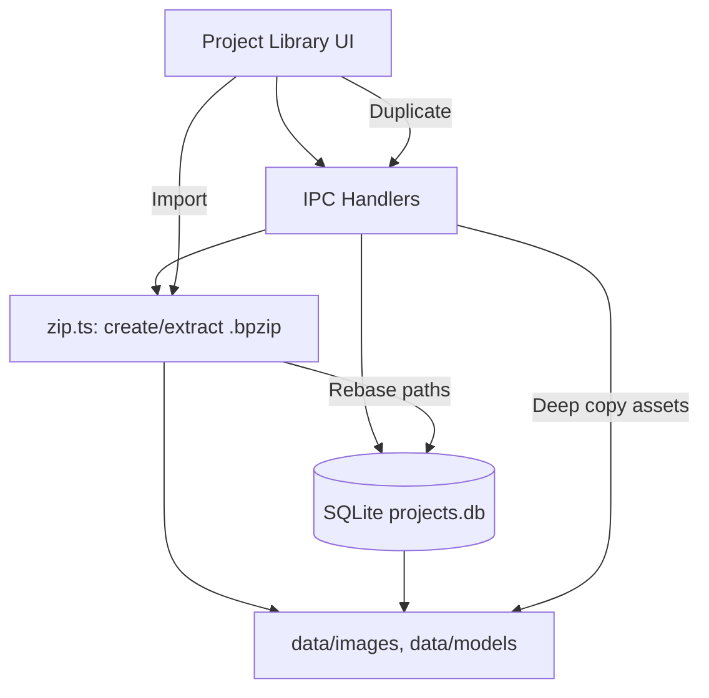

# Decision 001 — Phase 3: Project Library, Design Import/Export, Part Image Coverage

- **Date**: 2026-11-26
- **Council**: Product Council + Feature Council
- **Status**: Approved
- **Question**: What should Phase 3 of Blueprint PC cover, and what is the implementation scope?
- **Context**: Phase 1 (Foundation) and Phase 2 (Shell Restructuring) are complete. The app generates hardware designs from prompts, shows them in 7 tabs, compares prices across 4 retailers, maintains a 6,000+ part catalogue in SQLite, and persists projects to `projects.db`. All 154 self-checks pass.
- **Decision**: Approved scope — Phase 3 = Project library (A) + Design import/export (C) + Part image coverage (E). CAD export (B) and Schematik MCP enrichment (D) deferred to Phase 4.

---

## Rationale Summary

### Candidate directions considered

| Direction | Addresses | Nature of work | Risk | Decision |
|-----------|-----------|----------------|------|----------|
| **A** Project library | "One design at a time" | Frontend + thin backend | Low | **Include (MVP)** |
| **C** Design import/export | "No sharing" | Serialization + zip bundling | Low-Medium | **Include (fast-follow)** |
| **E** Part image coverage | "Photos best-effort" | Fallback chain improvements | Low | **Include (fast-follow)** |
| **B** Real CAD export | "No real CAD export" | Technical spike (OpenCASCADE-class kernel) | High | **Defer to Phase 4** |
| **D** Schematik MCP enrichment | Brittle price scraping | New dependency, sync logic | Medium | **Defer to Phase 4** |

### Key decisions

1. **Duplicate deep-copies assets (images + models)** — When duplicating a project, all referenced image and model files are copied to new local paths with new component IDs. This avoids shared mutable state between the original and duplicate.

2. **Export bundles assets into a single `.bpzip` file** — Export produces a zip containing the project JSON plus all referenced images and downloaded model files. Asset paths inside the bundle are relative, and are rebased to the local data directory on import.

3. **Part image fallback chain: retailer photos → Wikimedia Commons → category glyph** — No AI-generated placeholders (risk of misleading ordering photos). Wikimedia Commons already covers ~8 of 10 parts; the remaining 2 fall back to category glyphs.

### Why B and D are deferred

- **B (CAD export)** requires an OpenCASCADE-class solid-modelling kernel, which normally runs as a server service. A client-side or WASM path is a significant technical spike that needs its own investigation before committing.
- **D (Schematik MCP enrichment)** introduces a new dependency (MCP client) and cache-invalidation logic. Worth a separate spike so it doesn't block the UI-focused Phase 3 work.

---

## Council Votes

### Product Council

| Member | Vote | Key Points |
|--------|------|------------|
| Product Strategist (Lead) | Approve | Addresses #1 documented limitation. Local-first file sharing respects no-account philosophy. |
| Lean Delivery Lead | Concern | Three workstreams is ambitious. Recommend A as MVP, C/E as fast-follows. |
| Design Lead | Approve | Dedicated project library view needed — sidebar is cramped. No AI placeholders is correct. |
| Business Operations Lead | Approve | Zero new infrastructure cost. All local, no server/compliance burden. |
| Principal Engineer | Approve | SQLite already multi-project. `unzipper` already a dependency. Path rebasing is trickiest part. |
| Frontend Specialist | Approve | All frontend-heavy, low backend risk. |

### Feature Council

| Member | Vote | Key Points |
|--------|------|------------|
| Principal Engineer (Lead) | Approve | Straightforward plan. No new dependencies. 6-day estimate is reasonable. |
| Frontend Specialist | Approve | Project library view + import/export modals are clean UI additions. |
| Backend Specialist | Approve | IPC handlers already exist; need duplicate/archive/export/import. Zip logic self-contained. |
| QA Lead | Approve | 154 self-checks exist; add round-trip tests for duplicate/export/import. |

**Vote tally**: 5 Approve, 1 Concern (Lean Delivery Lead — scope size)

---

## Architecture

---

## Action Items

| # | Task | Layer | Size | Estimate | Dependencies |
|---|------|-------|------|----------|--------------|
| 1 | DB: Add `archived` column to `projects` table + migration | Database | XS | 0.5 day | None |
| 2 | IPC: `projects:duplicate`, `projects:archive`, `projects:export`, `projects:import` | Backend | M | 1.5 day | Task 1 |
| 3 | `src/main/zip.ts`: create/extract `.bpzip` bundle using `unzipper` | Backend | S | 0.5 day | `unzipper` dep present |
| 4 | `pages/ProjectLibrary.tsx`: project list with rename, duplicate, archive, delete | Frontend | M | 1.5 day | Tasks 2-3 |
| 5 | `pages/ExportDialog.tsx` + `pages/ImportDialog.tsx`: modals | Frontend | M | 1 day | Tasks 2-3 |
| 6 | `App.tsx`: route to ProjectLibrary; add export/import to command palette | Frontend | XS | 0.5 day | Tasks 4-5 |
| 7 | Self-checks: duplicate/export/import round-trip | Testing | S | 0.5 day | All above |

**Total: ~6 business days** (Medium complexity)

**Sequencing**: DB → Backend IPC → zip.ts → Frontend pages → Testing

---

## Risks & Mitigations

| Risk | Mitigation |
|------|------------|
| Asset path rebasing on import — absolute paths won't exist on another machine | Store relative paths in zip; rebase to local data dir on import |
| Duplicate deep-copy of large model files | Copy only referenced files; warn if total size > 100MB |
| Zip corruption | Validate zip integrity before import; show clear error if invalid |

---

## Success Metrics

1. User can create, rename, duplicate, archive, and delete projects from a dedicated library view
2. Exported `.bpzip` opens on a fresh machine with all images and models intact
3. Parts list photo coverage improves (fewer category-glyph fallbacks)

---

## References

- README.md — full current feature set and documented limitations
- `src/main/db.ts` — SQLite project database schema
- `src/main/ipc.ts` — existing IPC surface
- `package.json` — `unzipper` already a dependency
